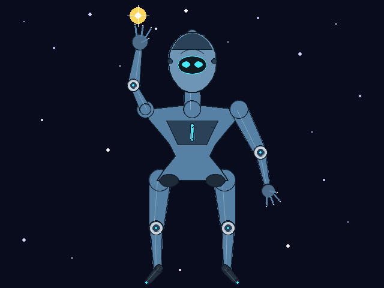
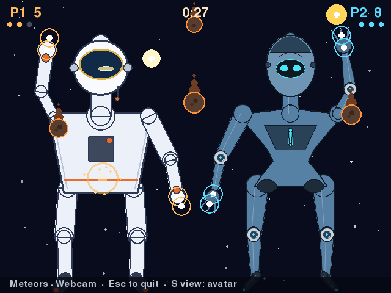

# Star Pop

Star Pop is a Python motion game in the spirit of an Xbox Kinect title. It tracks your whole body and lets you pop falling stars with either hand. A cartoon astronaut or a humanoid android is drawn over the tracked pose. Two people can play at once and dodge falling meteors while they grab stars.

The color image comes from an Xbox 360 Kinect (Kinect v1, through libfreenect), a webcam, or the mouse if no camera is available. Pose tracking uses Google MediaPipe Pose Landmarker (the lite model, on the CPU). The game is built for Apple Silicon Macs with Python 3.9–3.14 and pygame-ce (the stack it is developed on is Python 3.14).






## Quick start

From this folder in Terminal, on a Mac:

```bash
./setup.sh
./run.sh
```

`./setup.sh` is safe to run more than once. It installs Homebrew packages (including libfreenect), creates `.venv`, installs the Python packages, builds the `freenect` module, downloads the pose model if it is not already there, and checks the imports. `./run.sh` activates that virtualenv and starts the game. Extra arguments are passed through to `star_pop.py`.

Hardware, the Kinect USB adapter, manual install steps, and Apple Silicon notes are in [SETUP.md](SETUP.md).

## Flags

```bash
./run.sh                      # one player, falling stars (Kinect, else webcam, else mouse)
./run.sh --webcam             # webcam pose tracking, even if a Kinect is plugged in
./run.sh --depth              # closest-point Kinect depth tracking
./run.sh --mouse              # mouse only
./run.sh --avatar astronaut   # default cartoon suit
./run.sh --avatar robot       # bonus robot
./run.sh --avatar none        # no avatar
./run.sh --mode meteors       # solo meteor dodge
./run.sh --mode meteors --players 2
./run.sh --webcam --mode meteors --players 2
./run.sh --mouse --mode meteors --players 2   # mouse is P1, WASD or arrows move P2
./run.sh --preview-avatar     # draw a synthetic astronaut, save avatar_preview.png, and exit
./run.sh --preview-meteors    # save meteor_preview.png and exit
```

`--mode` is `stars` (the default) or `meteors`. `--players` is `1` (the default) or `2`. Leaving both off is the original one-player star game. Depth mode only has one closest point, so `--players 2` still plays single-player there.

## How to play

Stand far enough back that your whole body is in frame. Either hand pops a star. In pose mode, **S** cycles the overlay: avatar, avatar plus skeleton, skeleton, then none. The default is the astronaut with no stick figure. Escape quits.

With `--players 2`, whoever starts on the left is **P1** (astronaut, unless you passed `--avatar robot`) and whoever starts on the right is **P2** (the other suit: a steel-blue humanoid android when P1 is the astronaut). Those labels stick when you cross. One person in frame just plays alone; the empty side shows `--` until someone joins. A person who shows up alone on the right is P2, so a friend can still walk in on the left as P1.

`--mode meteors` drops rocks from the top. They speed up and come more often over a **45 second** round. A hit on the head, torso, or a limb costs a life (you start with **3**, and you are safe for a second after a hit). Stars are still worth a point each. When time runs out, the higher score wins, with lives as the tiebreak. If the other player is knocked out first, the one still standing wins. After the round, press **R** or **Space**, or hold **both hands up**, to play again.

Mouse testing: the pointer moves P1. With `--players 2`, **WASD** or the arrow keys move P2. Star mode keeps the plain cursor. Meteor mode draws a stand-in body under that cursor so you can dodge without a camera. Depth mode stays a single closest point.

## Pose model

`models/pose_landmarker_lite.task` (about 5 MB) is not stored in git. `./setup.sh` downloads the official MediaPipe lite model when the file is missing, and leaves an existing copy alone. The game does the same on the first pose-mode launch. A fresh clone only needs `./setup.sh` (or a pose-mode launch) to fetch it.
